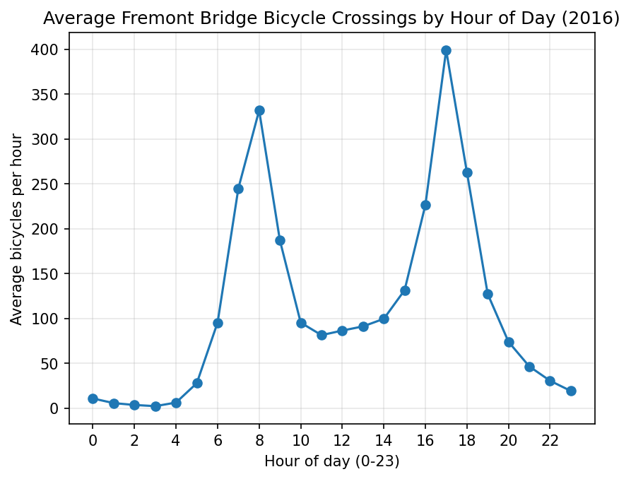

# CSE 583 HW 1: Fremont Bridge Bicycle Data Analysis

## AI assistance disclosure
I used **Claude** for this homework. It helped explained pandas functions and debug errors. It also helped me set up the `.gitignore`. I ran all the code myself, looked at the output, and wrote the comments in `hw1.py` based on what I saw in my data.

## Process
I started by setting up the folders and downloading the data, then read it in with pandas. The dates came in as plain strings, so I converted them to datetimes, which let me pull out the hour and year. I added a Total column (East + West), filtered to 2016, and checked for missing data. There was only one missing hour, March 13 at 2 AM. I think that's because of daylight saving time (clocks skip that hour), but I didn't verify that. I dropped it.

For the plot I took the average count for each hour of the day. I went with the average instead of the yearly total since the next question asks about the busiest hour on average. The busiest hour is **17** (5 PM), with about 399 bikes per hour.

## Problems I ran into
- **NumPy/matplotlib error.** `import matplotlib` crashed because my matplotlib was built for NumPy 1.x but NumPy 2.2.6 was installed.
- **`FileNotFoundError`.** I ran the script from the wrong folder, and `read_csv("bicycle_data.csv")` looks relative to the current directory. Running it from `hw1_data_analysis/` fixed it.
- **Python version.** `pyproject.toml` asks for Python >= 3.13, but I ran the script on Python [your version].

## Result

The plot has two peaks: a smaller **morning commute** peak around hour 8 and a larger **evening commute** peak at hour 17.

## Bonus: datetime formats

I converted the `Date` column with `pd.to_datetime(df["Date"], format="%m/%d/%Y %I:%M:%S %p")`.

- **`datetime.datetime`**: Python's built-in type for a *single* timestamp. Fine for one value, slow for a whole column.
- **NumPy `datetime64`**: a compact, *fast array* type for many timestamps at once.
- **pandas datetime**: built on NumPy's `datetime64`, and adds extras like the `.dt` accessor (I used `.dt.hour` and `.dt.year`).